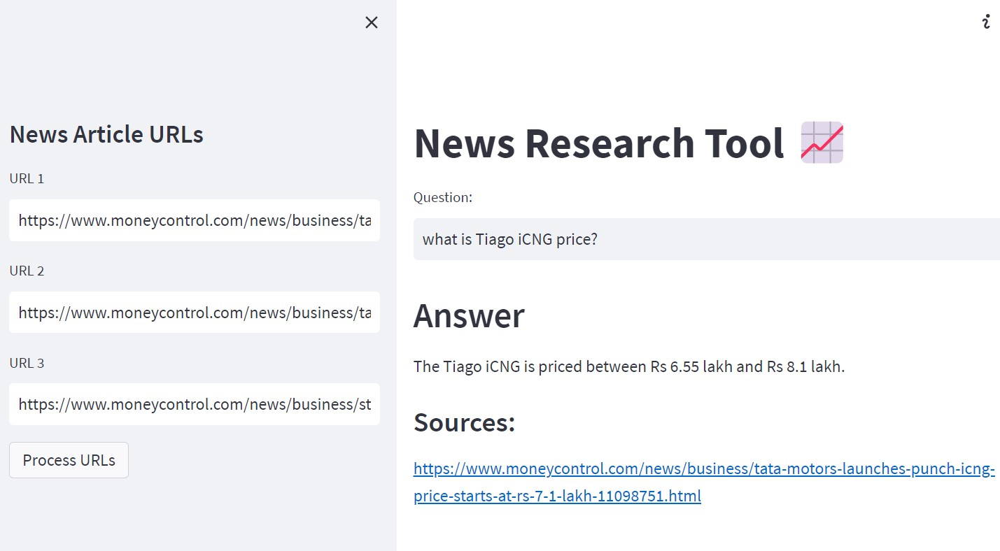

# FinSight – AI-Powered Financial News Intelligence 📈

FinSight is a news research tool I built to make it easier to explore financial news and understand what's happening in the market.

You can add article URLs, process their content, and ask questions about the information in those articles. Instead of going through multiple articles manually, FinSight retrieves relevant information and generates answers with source references.



## Features

- Add up to three news article URLs through the Streamlit sidebar.
- Extract article content using LangChain's `UnstructuredURLLoader`.
- Split the extracted content into smaller chunks for better retrieval.
- Generate text embeddings using Hugging Face's Sentence Transformers.
- Store and search relevant information using FAISS vector search.
- Ask questions about the processed articles.
- Generate AI-powered answers using Google's Gemini model.
- Display source references alongside the generated answers.

## Tech Stack

- **Python** – Core programming language
- **Streamlit** – Web application interface
- **LangChain** – Document processing and retrieval workflow
- **Google Gemini** – Answer generation
- **Hugging Face Sentence Transformers** – Text embeddings
- **FAISS** – Vector storage and similarity search

## Getting Started

### 1. Clone the repository

```bash
git clone https://github.com/ridika13/FinSight-AI.git
cd FinSight-AI
```

### 2. Install dependencies

```bash
pip install -r requirements.txt
```

### 3. Configure your API key

Create a `.env` file in the project root and add your Google Gemini API key:

```env
GOOGLE_API_KEY=your_google_api_key_here
```

You can obtain an API key from [Google AI Studio](https://aistudio.google.com/apikey).

Keep your `.env` file private. Do not upload API keys to GitHub.

### 4. Run the application

```bash
streamlit run main.py
```

The application will open in your browser.

## How to Use

1. Enter financial news article URLs in the sidebar.
2. Click **Process URLs** to start extracting and processing the articles.
3. FinSight splits the content into smaller chunks and generates embeddings.
4. The resulting vectors are stored in a FAISS index.
5. Enter a question in the question field.
6. View the generated answer and the sources used to retrieve the information.

## Project Structure

```text
FinSight-AI/
│
├── main.py
├── requirements.txt
├── README.md
├── .gitignore
├── LICENSE
├── FinSight.jpg
│
└── notebooks/
    ├── retrieval.ipynb
    ├── faiss_tutorial.ipynb
    └── text_loaders_splitters.ipynb
```

## Future Improvements

- Support for uploading documents alongside article URLs.
- Improved handling of websites that restrict automated content extraction.
- Better source organization and research history.
- Additional financial news analysis features.

## Acknowledgement

This project was developed as a learning project based on the LangChain and News Research Tool tutorials by [Codebasics](https://github.com/codebasics/langchain), with modifications including Gemini integration, Hugging Face embeddings, and the FinSight interface.

